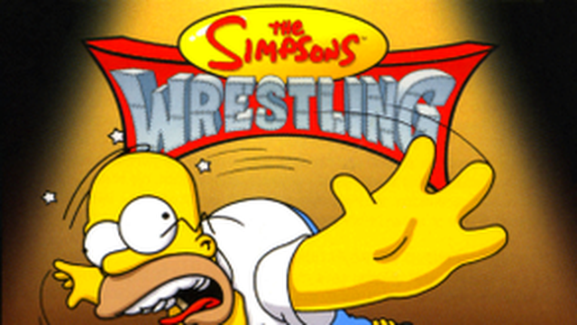

# The Simpsons Wrestling on Android TV



The same recompiled game as the PC version, packaged as an Android TV app. It
shows up on the TV home screen with the banner above, opens on a launcher
screen you can drive with the remote (choose your disc, settings, **PLAY**),
and runs the game full screen.

Made for **low-end TV boxes and TVs** (Mi Box, Chromecast with Google TV, Fire
TV Stick, cheap Android 7+ boxes). The APK is **armeabi-v7a** (32-bit ARM) by
default, which installs on both 32-bit and 64-bit ARM TVs:

- the **software renderer** at the original resolution: only OpenGL ES 2 is
  needed to show the picture, no desktop OpenGL or Vulkan
- **30 FPS by default** (the original game speed); faster boxes can switch on
  60 FPS and 720p in the launcher
- widescreen, skip intro, unlock everything and fast loading work as on PC

## What you need

- **Your own disc image** of The Simpsons Wrestling (PlayStation, USA,
  SLUS-01227): a `.cue` with its `.bin`, a single `.bin`, or a `.chd`. No game
  data is included.
- A **gamepad** (Bluetooth or USB) is best. The TV remote works too:
  D-pad = D-pad, OK = ✕, Back = △, Menu or Play/Pause = START.

## Getting the disc onto the TV

Any of these:

1. **Google Drive**: upload the disc image (a `.chd`, a single `.bin`, or a
   `.zip` holding the `.cue` and `.bin`), share it as "Anyone with the link",
   then pick **Import from Google Drive link…** in the app and type or paste
   the link. The app downloads it straight to the TV.
1. Copy it to a USB stick or the TV's Download folder, then pick
   **Choose disc image…** in the app. If the TV has no file picker, the app
   searches Downloads and USB drives itself.
2. Copy it into the app's own folder; the app finds it on its own:
   `adb push "Simpsons Wrestling, The (USA).cue" "Simpsons Wrestling, The (USA).bin" /sdcard/Android/data/io.github.ganley100.simpsonswrestling/files/disc/`

## Building the APK

The game's code is translated from **your** disc on your computer, exactly as
for the PC build, so the APK has to be built by someone with the disc.

1. Install the Android SDK (Android Studio, or the command-line tools) and
   Java 17 or newer. Set `ANDROID_HOME` to the SDK. Gradle downloads NDK
   27.2.12479018 and CMake 3.31.6 itself if the SDK licences are accepted
   (`sdkmanager --licenses`).
2. Translate the game (once):

   ```sh
   git submodule update --init --recursive
   python3 psxrecomp/psxrecomp_cli.py generate --config game.toml --project-root . \
       --disc "path/to/Simpsons Wrestling, The (USA).cue"
   ```

3. Build:

   ```sh
   ./build_android.sh                                 # armeabi-v7a (default)
   ./build_android.sh -Pabis=armeabi-v7a,arm64-v8a    # also a 64-bit build
   ```

   On Windows: `cd android` then `gradlew.bat assembleRelease`.

4. Install on the TV (turn on Developer options → USB/network debugging):

   ```sh
   adb connect <tv-ip-address>
   adb install -r android/app/build/outputs/apk/release/app-release.apk
   ```

   Or copy the APK to a USB stick and open it with a file manager on the TV.

**One-file install:** `./build_android.sh -PbundleDisc="path/to/your.chd"` (or
a `.cue`, which brings its `.bin` along) puts your disc image inside the APK.
The app unpacks it on first start and PLAY works straight away. Such an APK
contains the game: keep it to yourself and never publish it.

`-PallowSetupHost=true` builds without `generated/` (an engine-only APK that
cannot play the game; useful to check the toolchain).

Game output goes to logcat: `adb logcat -s SimpsonsWrestling`.

## How the port works

| File | What it does |
| --- | --- |
| `native/CMakeLists.txt` | Builds the repository's normal CMake project with the NDK, with the game as `libmain.so` instead of a program |
| `native/android_fiber.c` | The runtime's cooperative fibers (PlayStation BIOS threads). The POSIX version uses `ucontext`, which Android lacks; this is a small register-saving stack switch for ARM64, ARMv7 and x86-64 |
| `native/android_host.c` | Moves the game into the app's files folder before `main()` and sends its output to logcat |
| `native/android_gl_compat.c` | Two desktop-OpenGL-only functions the (unused on Android) OpenGL renderer references |
| `native/collect_assets.cmake` | Puts game.toml (software renderer), mods and the bundled OpenBIOS into the APK |
| `app/.../LauncherActivity.java` | The TV launcher screen: disc, settings (`launcher.txt`, `settings.toml`, `keybinds.ini`), PLAY |
| `app/.../GameActivity.java` | SDL's activity running the game, in its own process |
| `app/src/main/java/org/libsdl/app` | SDL 3.4.10's Java glue, matching the SDL version psxrecomp pins (zlib licence) |
